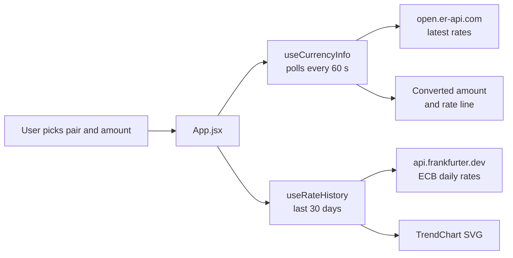

<div align="center">

# Live Currency Converter

**Convert between 160+ currencies at live market rates, with a 30-day trend chart for the selected pair.**

### [Live demo →](https://currency-exchange-app-rahuls-projects-98687e81.vercel.app/)


</div>

---

## What it does

Pick two currencies, type an amount and see what it is worth right now. Rates refresh every minute, and a small chart
shows how the pair has moved over the last 30 days. It runs entirely in the browser on free, keyless APIs, so there is
no backend and no API key to manage.

## Features

- **Live rates for 160+ currencies**, refreshed every 60 seconds, with a countdown and a "Refresh now" button.
- **30-day trend chart** for the selected pair, drawn as a hand-built SVG line chart with percent change, low and high.
- **Readable currency names** (for example "INR · Indian Rupee") generated in the browser with `Intl.DisplayNames`.
- **Large-number friendly**: Indian digit grouping for INR (1,00,00,000), lakh/crore hints for INR and "million"/"billion" hints for other currencies.
- **One-click swap** that also carries the converted amount over.
- **Common pairs** (USD→INR, EUR→USD, GBP→INR, USD→JPY, AED→INR) and **remembers your last pair** in `localStorage`.
- **Accessible**: labelled inputs, visible keyboard focus, `aria-live` rate announcements, an accessible chart label and reduced-motion support.
- **Resilient**: in-flight requests are cancelled when the pair changes, errors show a clear message and the next refresh retries automatically. If no history exists for a pair, the chart says so and conversion still works.
- **Banknote-inspired design**: guilloche rosette background, deep teal ink and a gold foil accent.

## How it works



- [`src/hooks/useCurrencyInfo.js`](src/hooks/useCurrencyInfo.js) fetches all rates for the base currency from
  `https://open.er-api.com/v6/latest/{BASE}`, re-polls on an interval and cancels stale requests with `AbortController`.
- [`src/hooks/useRateHistory.js`](src/hooks/useRateHistory.js) fetches daily rates for the pair from the
  [Frankfurter](https://frankfurter.dev) API (European Central Bank data) for the last 30 days.
- [`src/components/TrendChart.jsx`](src/components/TrendChart.jsx) turns those points into an SVG path, with no chart library.
- [`src/utils/format.js`](src/utils/format.js) handles input cleaning, locale-aware formatting and lakh/crore wording.

### Data sources

| Purpose | Source | Coverage | Key needed |
| :--- | :--- | :--- | :--- |
| Live rates | [ExchangeRate-API open access](https://www.exchangerate-api.com/docs/free) (`open.er-api.com`) | 160+ currencies | No |
| 30-day history | [Frankfurter](https://frankfurter.dev) (European Central Bank data) | About 30 major currencies | No |

Rates are mid-market and for information only.

## Tech stack

| Area | Technology |
| :--- | :--- |
| UI | React 18 (hooks) |
| Build tool | Vite 5 with `@vitejs/plugin-react` |
| Styling | Tailwind CSS 3, PostCSS, Autoprefixer, custom colour tokens |
| Charts | Hand-written SVG |
| Data | Browser `fetch` with `AbortController`, `Intl` APIs for names and number formatting |
| Hosting | Vercel |

## Project structure

```text
src/
├── components/
│   ├── InputBox.jsx             Amount and currency field
│   ├── TrendChart.jsx           SVG line chart
│   └── GuillocheBackground.jsx  Banknote-style background
├── hooks/
│   ├── useCurrencyInfo.js       Live rates and polling
│   └── useRateHistory.js        30-day history
├── utils/
│   └── format.js                Number formatting, lakh/crore wording
├── App.jsx                      Page layout and state
├── main.jsx                     Entry point
└── index.css                    Tailwind layers and base styles
```

## Getting started

Requires [Node.js](https://nodejs.org) 18 or later.

```bash
git clone https://github.com/Rahul-web01/Currency-Exchange-App.git
cd Currency-Exchange-App
npm install
npm run dev
```

Vite prints the local URL (http://localhost:5173 by default).

| Command | What it does |
| :--- | :--- |
| `npm run dev` | Start the development server with hot reload |
| `npm run build` | Build for production into `dist/` |
| `npm run preview` | Serve the production build locally |

### Deploy

Push to GitHub and import the repository in Vercel. It detects Vite automatically, and no environment variables are
needed for the default data sources.

## Roadmap

- Intraday data from a paid provider (such as Twelve Data or Alpha Vantage) for pairs outside the ECB set, with the key kept in a Vercel environment variable
- Selectable chart ranges beyond 30 days

## Author

**Rahul Singh**

[](https://github.com/Rahul-web01)
[](https://www.linkedin.com/in/rahul-singh-cs/)

---

<div align="center">

If you found this useful, consider giving it a ⭐

</div>
